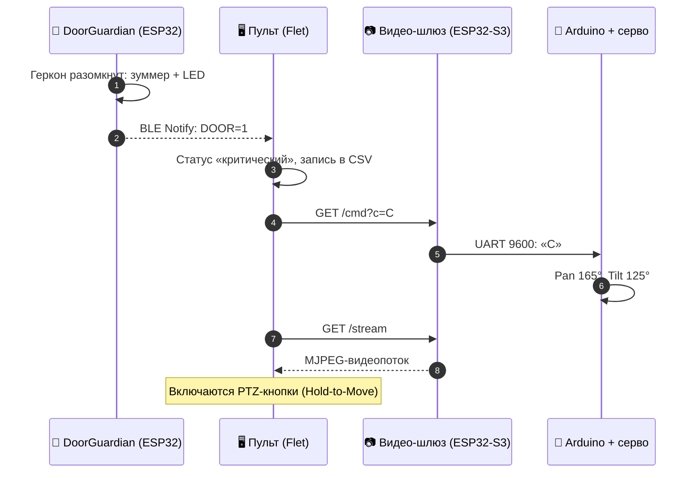
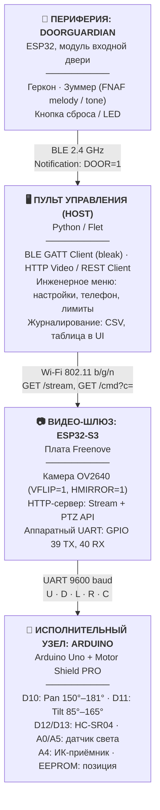

<div align="center">

# 🛡️ DoorGuardian

### Комплексная система безопасности и телеметрии с FPV-роботом / турелью


*Инженерная спецификация · Действующий прототип*

</div>

---

## 📑 Содержание

1. [Назначение системы и концепт](#1-назначение-системы-и-концепт)
2. [Архитектура и топология связи](#2-архитектура-и-топология-связи)
3. [Аппаратная спецификация и распиновка](#3-аппаратная-спецификация-и-распиновка)
4. [Протоколы взаимодействия](#4-протоколы-взаимодействия-и-данных)
5. [Подсистема SMS (GSM)](#5-инженерный-анализ-подсистемы-sms-gsm)
6. [Критические ошибки и уроки](#6-критические-ошибки-и-извлечённые-уроки-post-mortem)
7. [Базовые исходные коды](#7-базовые-исходные-коды-узлов)
8. [Архитектура и инварианты приложения (Flet)](#8-архитектура-и-инварианты-приложения-на-python-flet)
9. [Чек-лист ввода в эксплуатацию](#9-чек-лист-для-ввода-в-эксплуатацию)

---

## 1. Назначение системы и концепт

Система представляет собой **распределённый аппаратно-программный комплекс безопасности**. Он сочетает три части:

| Часть | Роль |
|---|---|
| 🚪 **Стационарный мониторинг входного узла** | Модуль двери DoorGuardian следит за герконом |
| 🤖 **Мобильно-поворотный узел видеонаблюдения** | Робот / турель с камерой |
| 🖥️ **Центральный пульт управления** | Приложение на Python / Flet |

### Ключевой сценарий работы (Event-Driven Pipeline)

**Режим ожидания.** Охранный модуль двери (DoorGuardian) отслеживает состояние геркона. Видеокамера и турель находятся в дежурном режиме. Пульт мониторит BLE-пакеты.

**Событие проникновения (`DOOR=1`):**

1. Размыкание геркона на модуле двери немедленно активирует локальный сигнал тревоги: зуммер с полифонией и предупредительный LED.
2. DoorGuardian транслирует статус тревоги в эфир по протоколу BLE (GATT Notify).
3. Центральное приложение Flet перехватывает событие, меняет статус на критический, делает запись в защищённый локальный журнал (CSV) и подаёт команду по Wi-Fi (HTTP) на камеру ESP32-S3.
4. ESP32-S3 через аппаратный UART отдаёт команду `C` (Center) контроллеру Arduino.
5. Сервоприводы позиционируют камеру прямо на входную зону (**D10: 165°, D11: 125°**).
6. В интерфейсе оператора разворачивается живой видеопоток (MJPEG) и активируются элементы PTZ-управления с поддержкой удержания клавиш.



---

## 2. Архитектура и топология связи



<details>
<summary>📟 Та же схема в ASCII (для просмотра без Mermaid)</summary>

```text
 +-----------------------------------------------------------------------------------+
 |                             ПУЛЬТ УПРАВЛЕНИЯ (HOST)                               |
 |                      Центральное приложение: Python / Flet                         |
 |  - BLE GATT Client (bleak)                      - HTTP Video / REST Client        |
 |  - Инженерное меню (настройки, телефон, лимиты) - Журналирование (CSV, UI Table)  |
 +-----------------------+----------------------------------+------------------------+
                         | (BLE 2.4 GHz)                    | (Wi-Fi 802.11 b/g/n)
                         | Notification: "DOOR=1"           | GET /stream, GET /cmd?c=
                         v                                  v
 +----------------------------------+      +-----------------------------------------+
 |     ПЕРИФЕРИЯ: DOORGUARDIAN      |      |          ВИДЕО-ШЛЮЗ: ESP32-S3           |
 |     Модуль входной двери (ESP32) |      |         Плата Freenove / Приклад. роб.  |
 |  - Геркон (магнитный контакт)    |      |  - Камера OV2640 (VFLIP=1, HMIRROR=1)   |
 |  - Зуммер (FNAF melody / tone)   |      |  - HTTP Web-сервер (Stream + PTZ API)   |
 |  - Кнопка сброса / LED           |      |  - Аппаратный UART (GPIO 39 TX, 40 RX)  |
 +----------------------------------+      +--------------------+--------------------+
                                                                |
                                                                | UART 9600 baud
                                                                | Байты: 'U','D','L','R','C'
                                                                v
                                           +-----------------------------------------+
                                           |      ИСПОЛНИТЕЛЬНЫЙ УЗЕЛ: ARDUINO       |
                                           |      Arduino Uno + Motor Shield PRO     |
                                           |  - D10: Серво Pan (Горизонт: 150°-181°) |
                                           |  - D11: Серво Tilt (Вертикаль: 85°-165°)|
                                           |  - D12/D13: Ультразвук HC-SR04          |
                                           |  - A0/A5: Датчик освещенности           |
                                           |  - A4: ИК-приемник                      |
                                           |  - EEPROM: Сохранение позиции           |
                                           +-----------------------------------------+
```

</details>

---

## 3. Аппаратная спецификация и распиновка

### 3.1. Исполнительный узел · Arduino Uno + Applied Robotics PRO Motor Shield

| Параметр | Значение |
|---|---|
| Микроконтроллер | ATmega328P (5 V, 16 МГц) |
| Питание | Сборка 2S Li-ion (7.4 V) через силовой разъём Motor Shield |

> [!IMPORTANT]
> Для подачи 5 V на датчики и сервоприводы **синяя кнопка с фиксацией на шилде должна быть нажата**. Питания только от USB-порта недостаточно для ультразвукового датчика и силовых сервомашинок.

#### Распиновка интерфейсов

| Пин | Назначение |
|:---:|---|
| `D0` (RX) | Линия приёма команд от ESP32-S3 (GPIO 39) |
| `D1` (TX) | Линия телеметрии к ESP32-S3 (GPIO 40) |
| `D10` | Сервопривод панорамирования (Горизонт / Pan) |
| `D11` | Сервопривод наклона (Вертикаль / Tilt) |
| `D12` | Ультразвуковой дальномер HC-SR04: **TRIG** |
| `D13` | Ультразвуковой дальномер HC-SR04: **ECHO** |
| `A0` | Фоторезистор / датчик света: аналоговый выход (AO) |
| `A4` | ИК-приёмник TSOP (Data pin) |
| `A5` | Фоторезистор / датчик света: цифровой пороговый выход (DO) |

#### Калибровочные ограничения сервоприводов (жёсткий контур безопасности)

| Ось | Пин | Базовый центр | Рабочий диапазон |
|---|:---:|:---:|:---:|
| **Горизонт (Pan)** | `D10` | 165° | 150° … 181° |
| **Вертикаль (Tilt)** | `D11` | 125° | 85° … 165° |

- **D10 (Горизонт).** Программный потолок (лимит): **300°**. Это зафиксированное системное требование. Искусственные жёсткие ограничения до 180° снимаются на верхнем уровне, физический упор ограничен логикой 150°…181°.
- **D11 (Вертикаль).** Направление **инвертировано**: команда «Вверх» (`U`) *уменьшает* угол сервопривода D11, команда «Вниз» (`D`) *увеличивает* его.

#### Карта EEPROM

| Адреса | Размер | Содержимое |
|:---:|:---:|---|
| `0..1` | 2 байта (`int`) | Угол сервопривода D10 |
| `2..3` | 2 байта (`int`) | Угол сервопривода D11 |

### 3.2. Видео-шлюз · ESP32-S3 WROOM Camera (Freenove)

**Интерфейс камеры:** DVP, сенсор OV2640 с PSRAM.

#### Распиновка шины сенсора

| Сигнал | GPIO | Сигнал | GPIO |
|---|:---:|---|:---:|
| `XCLK` | 15 | `VSYNC` | 6 |
| `SIOD` (SDA) | 4 | `HREF` | 7 |
| `SIOC` (SCL) | 5 | `PCLK` | 13 |

Линии данных `Y2 … Y9`: GPIO **11, 9, 8, 10, 12, 18, 17, 16**.

#### Ориентация матрицы

Изображение аппаратно перевёрнуто, поэтому при инициализации включаются оба флага:

```cpp
sensor_t *s = esp_camera_sensor_get();
s->set_vflip(s, 1);
s->set_hmirror(s, 1);
```

#### Мост UART-связи с Arduino

| ESP32-S3 | | Arduino |
|:---:|:---:|:---:|
| GPIO 39 (TX) | ➜ | D0 (RX) |
| GPIO 40 (RX) | ⬅ | D1 (TX) |

Скорость: **9600 baud**.

### 3.3. Модуль охраны двери · DoorGuardian (ESP32 Standalone)

**Микроконтроллер:** ESP32-WROOM-32.

| GPIO | Назначение | Режим / примечание |
|:---:|---|---|
| `4` | Геркон (магнитный датчик открытия) | `INPUT_PULLUP`, замыкание на GND при закрытой двери |
| `21` | Тактовая кнопка (сброс / тревога) | `INPUT_PULLUP` |
| `16` | Светодиод индикации тревоги | Активный уровень `HIGH` |
| `5` | Пьезодинамик (buzzer) | Генерация звука через `tone()` (мелодия FNAF) |
| `34` | Вход аналогового датчика освещённости | `ADC1_CH6` |

#### BLE-параметры (Bluetooth Low Energy)

| Параметр | Значение |
|---|---|
| `DEVICE_NAME` | `DoorGuardian` |
| `SERVICE_UUID` | `4fafc201-1fb5-459e-8fcc-c5c9c331914b` |
| `CHARACTERISTIC_UUID_TX` (уведомления, `NOTIFY`) | `beb5483e-36e1-4688-b7f5-ea07361b26a8` |
| `CHARACTERISTIC_UUID_RX` (команды записи, `WRITE`) | `6d68efe5-04b6-4a85-abc4-c2670b7bf7fd` |

---

## 4. Протоколы взаимодействия и данных

### 4.1. Протокол BLE · DoorGuardian ➜ Host (Flet)

Пакеты телеметрии передаются строками формата `Key=Value`, разделитель `;`:

```text
DOOR=1;LIGHT=1240;ALARM=1;BTN=0
```

| Поле | Значения |
|---|---|
| `DOOR` | `0`: дверь закрыта (цепь замкнута на землю) · `1`: дверь открыта (магнит отведён) |
| `LIGHT` | Цифровое значение АЦП датчика освещённости двери (`0..4095`) |
| `ALARM` | `1`: активен режим локальной сирены · `0`: система в покое |
| `BTN` | Состояние физической кнопки |

### 4.2. Протокол HTTP API · Host (Flet) ➜ ESP32-S3

| Назначение | Запрос |
|---|---|
| 📹 MJPEG-стрим | `GET http://<ESP32_IP>:80/stream` (стандартный `multipart/x-mixed-replace`) |
| 🎮 PTZ-команда | `GET http://<ESP32_IP>:80/cmd?c=<COMMAND_CHAR>` |

Ответ на PTZ-команду: `HTTP 200 OK`, тело: `OK`.

#### Допустимые значения `c`

| Символ | Действие | Эффект на серво |
|:---:|---|---|
| `U` | Tilt Up: поднять камеру | угол D11 **уменьшается** |
| `D` | Tilt Down: опустить камеру | угол D11 **увеличивается** |
| `L` | Pan Left: повернуть влево | угол D10 уменьшается |
| `R` | Pan Right: повернуть вправо | угол D10 увеличивается |
| `C` | Center: сброс в центр | D10 = 165°, D11 = 125° |

```bash
# пример: вернуть турель в центр
curl "http://192.168.1.50/cmd?c=C"
```

### 4.3. Протокол UART · ESP32-S3 ➜ Arduino

| Параметр | Значение |
|---|---|
| Физический уровень | 9600 бод, 8-N-1 |
| Формат | Одиночные ASCII-символы **без** завершающих символов перевода строки: `U`, `D`, `L`, `R`, `C` |

> [!WARNING]
> **Правило фильтрации на стороне Arduino.** Все символы `\r`, `\n`, пробелы и мусор в UART должны отбрасываться. Сервоприводы реагируют исключительно на валидные байты команд. Секция `default:` с перемещением сервопривода **запрещена**, иначе возникает самопроизвольное дрожание.

---

## 5. Инженерный анализ подсистемы SMS (GSM)

### 5.1. Причины неработоспособности на модуле двери

Предыдущая попытка запустить отправку SMS на базе дверного узла DoorGuardian столкнулась со следующими факторами:

- ⚡ **Пиковое энергопотребление.** GSM-модули (SIM800L / A6) в момент поиска сети и передачи пакета потребляют в импульсе до **2.0 А**. Стабилизатор 3.3 V платы ESP32 не способен выдать такой ток, что приводит к циклическим перезагрузкам контроллера (*Brownout Reset*).
- 📡 **Конфликт ресурсов ESP32.** Одновременная работа радиочастотного тракта BLE и постоянный опрос `SoftwareSerial` / `HardwareSerial` при нестабильном питании приводят к зависанию стека FreeRTOS.

### 5.2. Сравнительный анализ размещения SMS в «голове» проекта

| Вариант интеграции | Плюсы | Минусы | Вердикт |
|---|---|---|:---:|
| **1. На плате Arduino** | Все исполнительные цепи собраны в одном месте | Аппаратный UART занят ESP32-S3. `SoftwareSerial` вызовет жёсткий конфликт прерываний с библиотеками `Servo.h` и `IRremote`: сервоприводы начнут хаотично дёргаться | ❌ Категорически не рекомендуется |
| **2. На модуле ESP32-S3** | Мощный двухъядерный процессор, есть свободные аппаратные порты UART1/UART2 | Требует отдельного импульсного DC-DC понижающего стабилизатора (на 4.0 V) с электролитическим конденсатором не менее 1000 мкФ | ⚠️ Допустимо при аппаратной доработке |
| **3. На центральном пульте (Flet / Host)** | Максимальная надёжность. Доступны облачные шлюзы (SMS API), отправка фото в Telegram либо USB-модем с прямым AT-управлением. Микроконтроллеры не нагружаются | Требует постоянной работы ПК / планшета или шлюза | ✅ **РЕКОМЕНДУЕМЫЙ ВАРИАНТ** |

---

## 6. Критические ошибки и извлечённые уроки (Post-mortem)

В процессе разработки и отладки комплекса были выявлены и локализованы следующие проблемы:

| # | Проблема | Причина | Решение |
|:---:|---|---|---|
| 1 | Ошибка прошивки Arduino `stk500_getsync()` | Линии на пинах D0/D1 (от ESP32-S3 или Bluetooth-модуля) шунтируют сигнал программатора CH340 при загрузке скетча по USB | Перед загрузкой любого скетча **физически отключать** разъёмы с пинов 0 и 1 |
| 2 | Ложный порт `COM1` в Windows | `COM1` на большинстве материнских плат — внутренний виртуальный интерфейс | Выбирать порт реального драйвера (CH340 или CP2102), обычно `COM3`, `COM4` и выше |
| 3 | Отказ сопряжения BLE по PIN-коду (`0000` / `1234`) | BLE-модули (в отличие от Bluetooth Classic) не поддерживают сопряжение на уровне системного стека ОС через стандартные PIN-коды | Подключаться напрямую из прикладного софта (библиотека `bleak`, по UUID сервиса) |
| 4 | Аппаратный обрыв сигнальных линий DuPont | Скрытый надлом жилы внутри обжимного разъёма шлейфа датчиков | Обязательная прозвонка мультиметром всех 4-проводных линий от датчиков и сервоприводов |
| 5 | Таймаут ультразвука (`46770 µs` / 795 см) | Просадка шины питания до 4.5 V при питании только от USB-порта ПК. HC-SR04 требует строго 5.0 V для корректного компаратора эхо-сигнала | Включить силовую батарею 7.4 V (синяя кнопка на шилде) на время измерений |
| 6 | Конфликт библиотеки IRremote и дальномера на пине 13 | IRremote по умолчанию захватывает пин 13 для светодиодной индикации (`ENABLE_LED_FEEDBACK`), подавляя входной сигнал Echo | Принудительно отключать индикацию при инициализации (см. код ниже) |
| 7 | Самопроизвольное дрожание и уход сервоприводов | Обработка символов перевода строки `\r\n` дефолтным блоком `switch-case` в цикле чтения UART | Чёткая изоляция командных байтов: обрабатываются только `U`, `D`, `L`, `R`, `C`. Символы с кодами 10, 13 и прочий шум полностью игнорируются |

**Исправление для проблемы № 6:**

```cpp
IrReceiver.begin(IR_PIN, DISABLE_LED_FEEDBACK);
pinMode(ECHO_PIN, INPUT); // Объявляется СТРОГО ПОСЛЕ begin IR!
```

---

## 7. Базовые исходные коды узлов

### 7.1. Микропрограмма Arduino · `turret_controller.ino`

<details>
<summary>📂 Показать код</summary>

```cpp
#include <Servo.h>
#include <EEPROM.h>
#include <IRremote.hpp>

// --- ПИНЫ ---
#define SERVO_PAN_PIN   10
#define SERVO_TILT_PIN  11
#define TRIG_PIN        12
#define ECHO_PIN        13
#define LIGHT_ANALOG    A0
#define LIGHT_DIGITAL   A5
#define IR_PIN          A4

// --- ОГРАНИЧЕНИЯ И КАЛИБРОВКА ---
// Серво 10 (Горизонт): рабочий сектор 150-181, системный лимит 300
#define PAN_MIN         150
#define PAN_MAX         181
#define PAN_CENTER      165

// Серво 11 (Вертикаль): рабочий диапазон 85-165
#define TILT_MIN        85
#define TILT_MAX        165
#define TILT_CENTER     125

#define STEP_ANGLE      6

Servo servoPan;
Servo servoTilt;

int currentPan = PAN_CENTER;
int currentTilt = TILT_CENTER;

void loadFromEEPROM() {
  EEPROM.get(0, currentPan);
  EEPROM.get(2, currentTilt);
  if (currentPan < PAN_MIN || currentPan > PAN_MAX) currentPan = PAN_CENTER;
  if (currentTilt < TILT_MIN || currentTilt > TILT_MAX) currentTilt = TILT_CENTER;
}

void saveToEEPROM() {
  EEPROM.put(0, currentPan);
  EEPROM.put(2, currentTilt);
}

void updateServos() {
  servoPan.write(currentPan);
  servoTilt.write(currentTilt);
}

void setup() {
  Serial.begin(9600);
  
  servoPan.attach(SERVO_PAN_PIN);
  servoTilt.attach(SERVO_TILT_PIN);
  
  loadFromEEPROM();
  updateServos();

  pinMode(TRIG_PIN, OUTPUT);
  digitalWrite(TRIG_PIN, LOW);
  
  // Инициализация ИК-приемника без захвата 13-го пина
  IrReceiver.begin(IR_PIN, DISABLE_LED_FEEDBACK);
  pinMode(ECHO_PIN, INPUT); // Строго после IrReceiver!

  pinMode(LIGHT_DIGITAL, INPUT);
}

long getDistanceCM() {
  digitalWrite(TRIG_PIN, LOW);
  delayMicroseconds(2);
  digitalWrite(TRIG_PIN, HIGH);
  delayMicroseconds(10);
  digitalWrite(TRIG_PIN, LOW);
  long duration = pulseIn(ECHO_PIN, HIGH, 30000);
  if (duration == 0) return -1;
  return duration / 58.2;
}

void loop() {
  // 1. Прием команд из аппаратного UART от ESP32-S3
  if (Serial.available() > 0) {
    char cmd = Serial.read();
    bool moved = false;

    switch (cmd) {
      case 'U': // Вверх (инверсия: уменьшаем угол)
        if (currentTilt - STEP_ANGLE >= TILT_MIN) {
          currentTilt -= STEP_ANGLE;
          moved = true;
        }
        break;
      case 'D': // Вниз (инверсия: увеличиваем угол)
        if (currentTilt + STEP_ANGLE <= TILT_MAX) {
          currentTilt += STEP_ANGLE;
          moved = true;
        }
        break;
      case 'L': // Влево
        if (currentPan - STEP_ANGLE >= PAN_MIN) {
          currentPan -= STEP_ANGLE;
          moved = true;
        }
        break;
      case 'R': // Вправо
        if (currentPan + STEP_ANGLE <= PAN_MAX) {
          currentPan += STEP_ANGLE;
          moved = true;
        }
        break;
      case 'C': // Центрирование
      case 'S':
        currentPan = PAN_CENTER;
        currentTilt = TILT_CENTER;
        moved = true;
        break;
      default:
        // Все остальные символы (\r, \n, пробелы) игнорируются!
        break;
    }

    if (moved) {
      updateServos();
      saveToEEPROM();
    }
  }

  // 2. Обработка ИК пульта (локальный дублер)
  if (IrReceiver.decode()) {
    // Резерв локального управления при необходимости
    IrReceiver.resume();
  }
}
```

</details>

### 7.2. Микропрограмма видео-шлюза · `esp32s3_gateway.ino`

<details>
<summary>📂 Показать код</summary>

```cpp
#include "esp_camera.h"
#include <WiFi.h>
#include <WebServer.h>

#define PWDN_GPIO_NUM     -1
#define RESET_GPIO_NUM    -1
#define XCLK_GPIO_NUM     15
#define SIOD_GPIO_NUM      4
#define SIOC_GPIO_NUM      5

#define Y9_GPIO_NUM       16
#define Y8_GPIO_NUM       17
#define Y7_GPIO_NUM       18
#define Y6_GPIO_NUM       12
#define Y5_GPIO_NUM       10
#define Y4_GPIO_NUM        8
#define Y3_GPIO_NUM        9
#define Y2_GPIO_NUM       11
#define VSYNC_GPIO_NUM     6
#define HREF_GPIO_NUM      7
#define PCLK_GPIO_NUM     13

const char* ssid = "YOUR_WIFI_SSID";
const char* password = "YOUR_WIFI_PASSWORD";

WebServer server(80);
HardwareSerial ArduinoSerial(1); // UART1

void handleCmd() {
  if (server.hasArg("c")) {
    String c = server.arg("c");
    if (c.length() > 0) {
      ArduinoSerial.print(c[0]); // Передача одиночного байта в Arduino
    }
    server.send(200, "text/plain", "OK");
  } else {
    server.send(400, "text/plain", "Missing c arg");
  }
}

void handleStream() {
  WiFiClient client = server.client();
  String response = "HTTP/1.1 200 OK\r\n"
                    "Content-Type: multipart/x-mixed-replace; boundary=frame\r\n\r\n";
  client.print(response);

  while (client.connected()) {
    camera_fb_t * fb = esp_camera_fb_get();
    if (!fb) break;

    client.print("--frame\r\n");
    client.print("Content-Type: image/jpeg\r\n");
    client.print("Content-Length: " + String(fb->len) + "\r\n\r\n");
    client.write(fb->buf, fb->len);
    client.print("\r\n");
    
    esp_camera_fb_return(fb);
  }
}

void setup() {
  Serial.begin(115200);
  // Аппаратный UART1 для связи с платой Arduino (D0/D1)
  ArduinoSerial.begin(9600, SERIAL_8N1, 40, 39); // RX: 40, TX: 39

  camera_config_t config;
  config.ledc_channel = LEDC_CHANNEL_0;
  config.ledc_timer = LEDC_TIMER_0;
  config.pin_d0 = Y2_GPIO_NUM;
  config.pin_d1 = Y3_GPIO_NUM;
  config.pin_d2 = Y4_GPIO_NUM;
  config.pin_d3 = Y5_GPIO_NUM;
  config.pin_d4 = Y6_GPIO_NUM;
  config.pin_d5 = Y7_GPIO_NUM;
  config.pin_d6 = Y8_GPIO_NUM;
  config.pin_d7 = Y9_GPIO_NUM;
  config.pin_xclk = XCLK_GPIO_NUM;
  config.pin_pclk = PCLK_GPIO_NUM;
  config.pin_vsync = VSYNC_GPIO_NUM;
  config.pin_href = HREF_GPIO_NUM;
  config.pin_sccb_sda = SIOD_GPIO_NUM;
  config.pin_sccb_scl = SIOC_GPIO_NUM;
  config.pin_pwdn = PWDN_GPIO_NUM;
  config.pin_reset = RESET_GPIO_NUM;
  config.xclk_freq_hz = 20000000;
  config.pixel_format = PIXFORMAT_JPEG;
  config.frame_size = FRAMESIZE_VGA;
  config.jpeg_quality = 12;
  config.fb_count = 2;

  esp_err_t err = esp_camera_init(&config);
  if (err != ESP_OK) {
    Serial.println("Camera init failed");
    return;
  }

  // Аппаратный разворот кадра
  sensor_t *s = esp_camera_sensor_get();
  if (s != NULL) {
    s->set_vflip(s, 1);
    s->set_hmirror(s, 1);
  }

  WiFi.begin(ssid, password);
  while (WiFi.status() != WL_CONNECTED) {
    delay(500);
  }

  server.on("/stream", HTTP_GET, handleStream);
  server.on("/cmd", HTTP_GET, handleCmd);
  server.begin();
}

void loop() {
  server.handleClient();
}
```

</details>

---

## 8. Архитектура и инварианты приложения на Python (Flet)

Центральное приложение объединяет интерфейс управления оператора, приём BLE-телеметрии и отправку команд управления PTZ.

> [!CAUTION]
> **Инварианты, которые запрещено удалять или урезать в UI:**

1. **Диалоговое окно настроек (`open_settings`).** Полноценное модальное окно с выбором сетевого адреса камеры, UUID сервисов BLE, конфигурацией номера телефона для SMS-оповещений и слайдером задержки тревоги.
2. **Система непрерывного шага (Hold-to-Move).** При зажатии экранных кнопок направлений (стрелок) поток запросов передаётся периодически (через таймер / цикл события), обеспечивая плавный поворот турели без необходимости сотен кликов мышью.
3. **Прямая инверсия по оси Tilt.** Кнопка «Вверх» отправляет букву `U`, кнопка «Вниз» отправляет букву `D`.
4. **Аварийный триггер центрации.** При переходе состояния `DOOR` из `0` в `1` приложение в приоритетном потоке вызывает `GET /cmd?c=C`, позиционируя турель точно на дверь, после чего активирует компонент вывода видеопотока.
5. **Экспорт журнала.** Кнопка выгрузки истории тревог в формате CSV с сохранением временных меток и данных датчиков освещённости.

---

## 9. Чек-лист для ввода в эксплуатацию

- [ ] **Шаг 1.** Отключить провода с контактов 0 и 1 на плате Arduino. Подключить USB-кабель, загрузить скетч `turret_controller.ino`. Отключить USB.
- [ ] **Шаг 2.** Вернуть провода UART от платы ESP32-S3 (`GPIO 39` ➜ `D0`, `GPIO 40` ➜ `D1`).
- [ ] **Шаг 3.** Установить сборку аккумуляторов 7.4 V в Motor Shield, нажать синюю кнопку питания (должен загореться силовой светодиод шилда).
- [ ] **Шаг 4.** Прошить видео-шлюз `esp32s3_gateway.ino`, предварительно указав параметры локальной сети Wi-Fi. Убедиться через монитор порта в получении IP-адреса.
- [ ] **Шаг 5.** Прошить дверной модуль DoorGuardian. Убедиться, что при размыкании магнита звучит зуммер и мигает LED.
- [ ] **Шаг 6.** Запустить на рабочем месте центральное приложение Python Flet. Ввести полученный IP-адрес камеры, выполнить подключение по BLE к имени `DoorGuardian`.
- [ ] **Шаг 7.** Провести тестовое размыкание геркона: проверить автоматический разворот турели в исходную позицию (165° / 125°) и начало трансляции видео с камеры.

---

<div align="center">

**DoorGuardian** · ESP32 · ESP32-S3 · Arduino · Python / Flet

</div>
